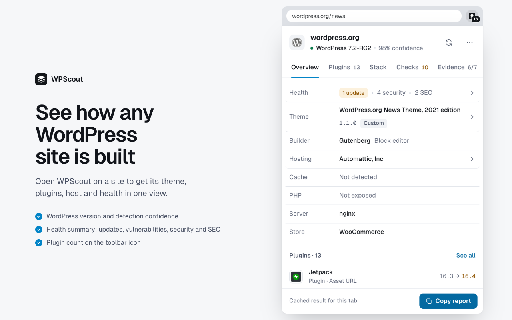

# WPScout 🔍

> **Scout Any WordPress Website in Seconds.**
> A modern, developer-first Chrome extension (Manifest V3) for deep WordPress stack inspection, plugin discovery, server diagnostics, real-time caching analysis, and DNS resolution.

[](https://chromewebstore.google.com/detail/pnfcaepdbhbioeplilbgliegcnclpake?utm_source=parag.xyz)
[](https://parag.xyz/WPScout/)
[](https://developer.chrome.com/docs/extensions/mv3/intro/)
[](https://opensource.org/licenses/MIT)



---

## 🌐 Official Links

- **Chrome Web Store:** [Install WPScout Extension](https://chromewebstore.google.com/detail/pnfcaepdbhbioeplilbgliegcnclpake?utm_source=parag.xyz)
- **Official Landing Page:** [https://parag.xyz/WPScout/](https://parag.xyz/WPScout/)
- **Support Developer:** [Wise Support Link](https://wise.com/pay/r/dY07p1CL5kn91qw)

---


## Overview

A Chrome extension (Manifest V3) that detects whether a site runs WordPress and shows its stack: version, theme, plugins, page builder, server, PHP, CDN, cache status, IP, host and DNS, along with the evidence for each finding.


## How it works

| File | Role |
|---|---|
| `content.js` | Runs on every page. A fast DOM check decides whether the page is WordPress, then `detectWordPress()` scans assets, inline scripts and styles, the response headers, `/wp-json` and the theme's `style.css`. Network checks run in parallel. |
| `background.js` | Service worker. Caches each tab's report in `chrome.storage.session`, sets the toolbar badge (plugin count), resolves the IP and nameservers (Google DNS) and the network and location (ipwho.is). It also caches those lookups per host and the REST API index per origin. |
| `popup/` | The 420 × 600 popup with Overview, Plugins, Stack, Checks and Evidence tabs, plus a settings pane for optional Wordfence and WPScan keys. It reads the cached report and adds names and icons from WordPress.org. `detect.js` is a copy of the detector, injected only when the content script can't be reached; keep it in sync with `content.js`. |

## Develop

1. Open `chrome://extensions`, turn on **Developer mode**, click **Load unpacked** and pick this folder.
2. After editing, click **Reload** on the extension card, then refresh the tab you're testing.
3. To preview the popup without the extension, open `popup/popup.html` in a browser tab. It uses sample data. Add a hash to pick a view: `#plugins`, `#hosting`, `#evidence`, `#dark`, `#loading`, `#empty`, `#internal`, `#menu`.

## Release

```bash
./scripts/build.sh
```

This writes `dist/wpscout-<version>.zip` containing only the runtime files. Store images and listing text are in `store/` (see `store/LISTING.md`).


Store screenshots and promo tiles are rendered from `store/source/store-template/store.html`; social images from `store/source/social/`.

The marketing site is in `website/`.

## 📄 License

This project is licensed under the [MIT License](LICENSE).
Feel free to use, modify, and contribute!
